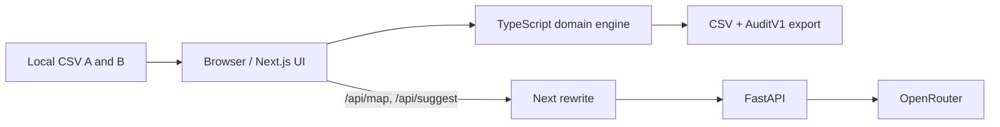
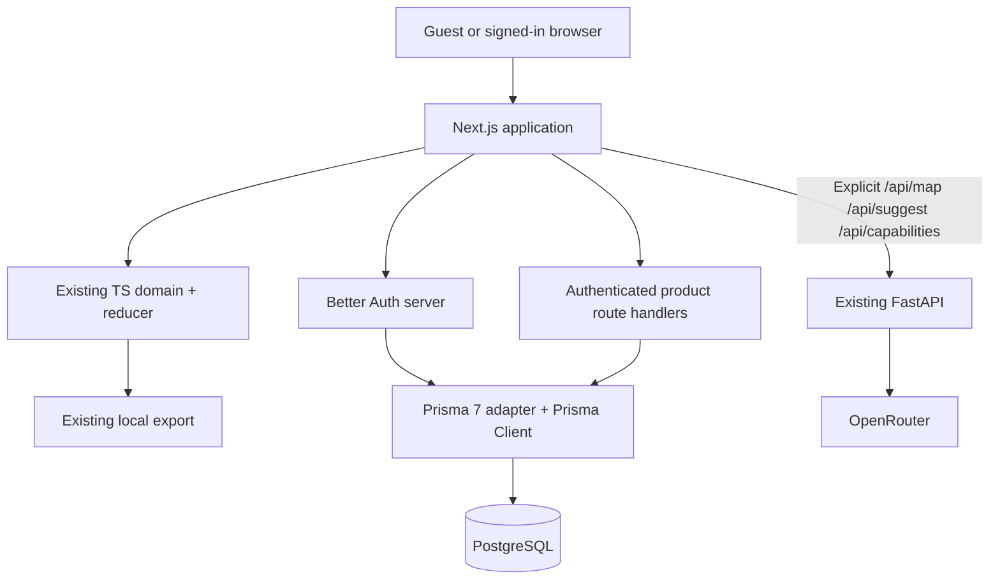

# Phase 05 — System architecture

**Status: Proposed.** As-is facts were read at `v0.1.0` (`c3ddc82`); future components in this document are NOT implemented.

## A. Current v0.1.0 architecture (implemented)



- `web/app/page.tsx` reads fixture CSVs at build time and renders `web/src/ui/AccordApp.tsx`.
- `AccordApp` owns `useAccordWorkflow()` and `useSuggestAnalysis()`. The pure workflow reducer delegates matching decisions to the deterministic `web/src/domain/` engine.
- Browser owns CSV parsing, identity hashes, mapping confirmation, decisions, quantity arithmetic and all three artifacts.
- FastAPI receives bounded fields for AI inference only, behind a same-origin rewrite. It does not store projects or own accepted matches.
- `replayAudit` verifies consistency of `AuditV1` and returns canonical CSV rows, not a hydrated `ReconciliationState`.
- Root `vercel.json` and `web/next.config.ts` route only `/api/map`, `/api/suggest` and `/api/capabilities` to FastAPI (implemented in 05-I/A; Vercel preview check pending). Every other `/api/*` path is Next's.
- Docker currently runs a hardened web and API pair. No database or account service exists.

## B. Target architecture for v0.2.0 (proposed)



### Ownership matrix

| Concern | Owner | May NOT own |
|---|---|---|
| CSV parsing, match policy, row accounting, quantity arithmetic | `web/src/domain/` | DB auth, React UI, HTTP, provider |
| Run generation, cancellation, workflow navigation | `web/src/workflow/`, `web/src/analysis/` | SQL or arbitrary server writes |
| Auth sessions, user identity | Better Auth in Next server runtime | Browser JWT parsing as authorization source, FastAPI |
| Private project CRUD, authorization, snapshots | Next server-only handlers and services | Accepting AI suggestions without human decision |
| PostgreSQL access and transactions | Prisma in `web/src/server/` (planned path) | Client bundles, FastAPI |
| AI mapping/suggestion request validation | Existing FastAPI | Session/database ownership, decisions |
| Source originals, download Blob URLs | Browser | Server project lists or logs |

## C. Runtime modes

**Guest mode:** `/` works without sign-in and without DB, including two CSVs, mapping, review and local export. AI calls continue to use existing configured model/cost guards. No automatic upload/persistence.

**Account mode:** auth is optional; a signed-in user can explicitly save a confirmed reconciliation to their personal workspace. Only the explicit save transmits the `AuditV1` payload to the Next product backend; snapshot persists in PostgreSQL. Server independently validates and enforces owner scoping. Logged-in user can reopen that version in a new session.

**Unavailable database:** guest UI must still render and allow local reconciliation. Authenticated project actions fail with a safe typed error, not an inaccessible homepage or false successful save.

## D. Route ownership, critical integration

**Implemented (05-I/A):** both layers are allowlists. In local Next and Docker, `rewrites()` forwards **only** `/api/map`, `/api/suggest`, `/api/capabilities`. Root Vercel services configuration lists those three exact paths for `api`, then `/(.*)` for `web`. Vercel evaluates top-level rewrites in order and routing into a service is final, so `/api/auth/*` and `/api/projects/*` already reach `web` without their own rules. Static tests (`web/src/routing/apiRouting.test.ts`), Playwright (`web/e2e/routing.e2e.ts`) and `scripts/docker-smoke.sh` cover this.

**Planned:** serve `/api/auth/[...all]` and `/api/projects/...` as Next Node route handlers. Prove preview routing; do not assume a rewrite inside Next can override an outer Vercel rule. A route that accidentally hits Python is a release blocker.

## E. Planned server-only code placement

```text
web/
  app/api/auth/[...all]/route.ts   # Better Auth adapter
  app/api/projects/...             # Authenticated handlers
  app/(account)/...                # Private pages; exact names to confirm
  src/server/auth.ts               # Auth setup, session guard
  src/server/db.ts                 # Prisma instance, server-only
  src/server/projects/...          # DB queries + owner scope + snapshot transactions
  src/domain/auditReplay.ts        # Minimal shared validation/restore extension
  src/ui/...                       # Existing AccordApp and small project adapter
  prisma/schema.prisma             # Existing auth models generated from pinned auth version
  prisma/migrations/...            # Checked-in schema changes
```

**Directories are targets, not an instruction to invent duplicates.** Before touching code, inspect existing paths and use the minimum working integration.

## F. Preservation checks

- No changes to `checkPair` semantics, exact ID policies, duplicate quarantines, Jaccard candidate retrieval or BigInt arithmetic.
- Keep `matches.csv`, `unresolved.csv`, `audit.json` as v0.1 schema and output ordering.
- Never initialize a second reducer or bypass `AccordApp` via an alternate reconciliation implementation.
- A server does not become the source of accepted matches; it validates the client's frozen snapshot and stores an immutable record.
- Do not leak source rows to public page HTML, metadata, logs or authenticated list responses.

## G. Deferred

Organizations, multiple workspace memberships, server-side authoritative matching, durable AI queues, object storage, versioned reusable datasets, imports from third-party systems and cross-instance rate limits are future decisions, not requirements of Phase 05-I.
