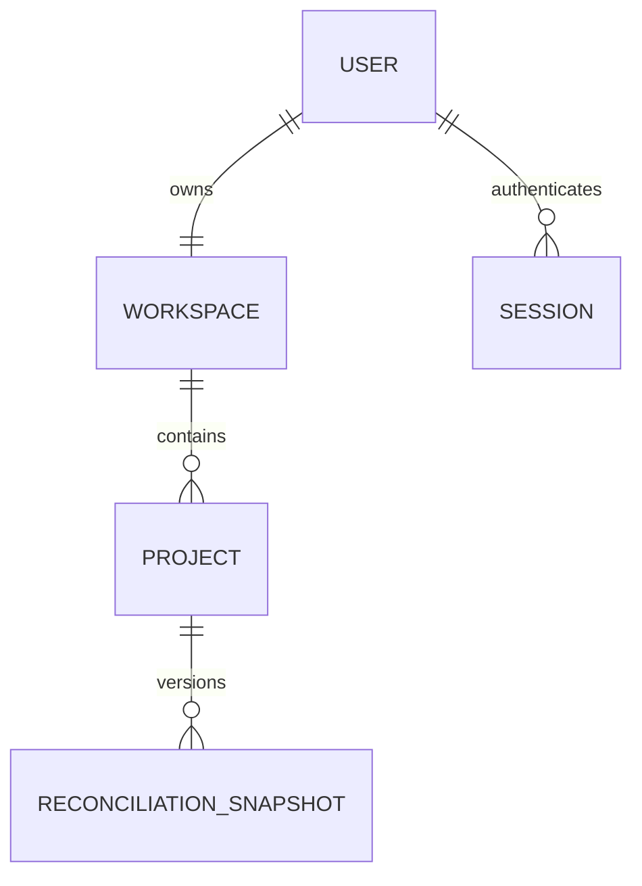

# Phase 05 — Data model and storage boundaries

**Status: Proposed, not migrated.** Details below describe a logical schema. Exact Better Auth models and Prisma generator/adapter configuration must be generated and verified using the pinned installed dependency versions during implementation.

## Why a small schema

`AuditV1` already records two parsed sources, mappings, proposals, decisions, accepted pairs, unresolved rows and model metadata. For the first persistent experience, store it as an immutable JSONB snapshot rather than splitting row and decision data into many tables. This avoids a second matching authority. Queryable decision analytics can be designed when a real use case requires it.

## Core entities

| Entity | Main fields | Database guarantees |
|---|---|---|
| Better Auth `User`, `Session`, `Account`, `Verification` | Generated by pinned Better Auth CLI | Library-required constraints; do not manually guess columns |
| `Workspace` | `id`, `ownerId`, `name`, `createdAt`, `updatedAt` | UNIQUE `ownerId`, FK user; one personal workspace per user |
| `Project` | `id`, `workspaceId`, `name`, `version` default `0`, timestamps | FK workspace; index `(workspaceId, updatedAt)` |
| `ReconciliationSnapshot` | `id`, `projectId`, `version`, `idempotencyKey`, `audit` JSONB, `auditSchemaVersion`, `configurationHash`, `domainRevision`, `createdAt` | FK project, UNIQUE `(projectId,version)`, UNIQUE `(projectId,idempotencyKey)`, index `(projectId, createdAt)` |

Suggested identifiers: random UUID/CUID strings generated server-side; never trust user-selected owner/workspace IDs. `Project.version` denotes **database snapshot sequence**, independent of `audit.revision`, which describes domain changes inside the engine.

## Relationships

User account deletion is **not** part of Phase 05-I; document it as a limitation. Project deletion explicitly cascades to its snapshots. Workspace protection is owner-only, no invite/member table.

## Immutable snapshot rules

1. Snapshot row created only after strict AuditV1 validation and invariant/replay checks.
2. Past snapshot rows are never updated; renaming a project does not mutate snapshots.
3. A request includes `expectedVersion` and stable `idempotencyKey`; transaction atomically advances project version and creates snapshot.
4. Two conflicting requests must yield one commit, one `409 VERSION_CONFLICT`; unique keys deduplicate retries.
5. Project list and metadata endpoints **never include** audit JSON; the latest-snapshot endpoint fetches only one permitted payload.
6. Save max payload: planned 4 MiB encoded JSON (server checks Content-Length when supplied and enforces actual received body size). Do not silently alter current CSV parser limits.
7. Parsed source records are sensitive; PostgreSQL at-rest protection, DB access controls and backup practices are deployment responsibilities.
8. DB uniqueness complements application checks. A malicious client cannot create cross-user data by specifying `ownerId` or reusing another project's snapshot ID.

## Workspace provisioning

On the first verified session request that needs a workspace, `upsert` by unique `ownerId` with a stable default name. Concurrent requests converge to one workspace; never rely on read-then-create without a unique constraint.

## Migration policy

- Prisma 7 and Better Auth compatibility must be pinned and confirmed against docs; do not copy speculative `User`/`Session` Prisma fields from this document.
- Better Auth CLI **generates schema**, Prisma `migrate dev` creates migration locally, Prisma `migrate deploy` applies committed migrations to deployed DB. Do not do production `db push` or `migrate reset`.
- Commit `schema.prisma`, migration SQL and lockfile as reviewed code.
- Rehearse fresh install, migration upgrade, persistence after Compose restart, and backup/restore in a disposable DB.
- Never modify v0.1 `AuditV1` schema version purely to add storage columns. Wrap it in DB metadata.

## Future questions, explicitly deferred

- Datasets as separately queryable entities for cross-run reuse.
- Project ownership transfer, organizations or memberships.
- Search/indexing inside audit content.
- Data retention schedules, account deletion workflow and data-region requirements.
