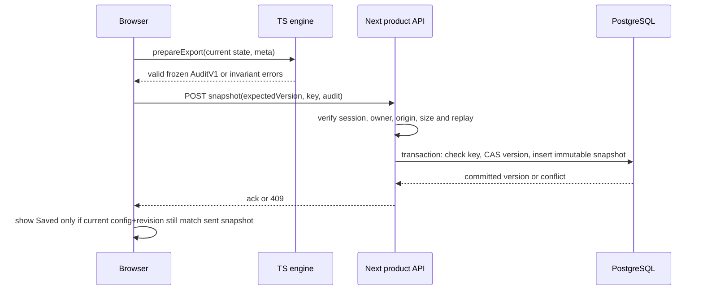

# Phase 05 — Snapshot persistence and verified restoration

**Status: Proposed.** This is the core correctness contract for Phase 05-I. Neither save nor restore currently exists in the v0.1 browser app.

## The immutable source of decisions

`web/src/domain/exportSnapshot.ts` produces `AuditV1` via `prepareExport` after `checkInvariants`. The audit includes two parsed datasets, configuration/hash, decisions, AI proposals and evidence, accepted pairs, unresolved reasons, analysis accounting and model-run metadata. It does **not** contain original CSV bytes. The ID hashes match the original bytes in the importing session, but a saved audit cannot re-hash them when reopened.

`web/src/domain/auditReplay.ts` currently exposes `replayAudit(input)` that validates semantic consistency and gives canonical output rows and CSV strings. **It does not return a `WorkflowState` or fully restored `ReconciliationState`.** Phase 05-I must add that capability by reusing the validator, not duplicating it with permissive JSON-to-state assignment.

## Save sequence



### Server transaction exactness

1. Verify session and project ownership in the DB first.
2. Read an existing `(projectId,idempotencyKey)` and return its first result if present (scope check already passed).
3. If absent, begin transaction; conditional update project `WHERE id=:project AND version=:expected` to `version+1`.
4. If no row updated: `409 VERSION_CONFLICT` (do not insert).
5. Insert snapshot `(projectId,version=expected+1,idempotencyKey,audit,metadata)` in that transaction. Unique constraints enforce a single result for same key/version.
6. Commit. Handle unique-key race by reading the winner and returning the same committed result. Treat other constraints as errors and rollback.

**No merge** between two tabs; keep losing tab's in-memory work and local export available. UI offers reload latest or continue with unsaved work, without overwriting server state.

### Client correctness

- Save is **explicit** and only for confirmed mapping, invariant-valid state and no running inference. No guest upload by default.
- Prepare one frozen snapshot and one idempotency UUID per save intent; HTTP retry of that intent reuses same key and exact audit.
- Do not use `Project.version` as `state.reconciliation.revision`. Compare both independently.
- After response, check current hash and revision against the sent frozen payload. If changed during network latency, show unsaved changes even if the earlier snapshot was saved successfully.
- Save error does not invalidate local reconciliation or previously valid exports.

## Restore sequence

```mermaid
sequenceDiagram
 participant Browser
 participant API as Next product API
 participant Replay as Shared domain validator
 Browser->>API: GET latest snapshot
 API->>API: verify session and owner
 API-->>Browser: private AuditV1 + project version
 Browser->>Replay: strict validate, reconstruct state and invariants
 Replay-->>Browser: trusted restore state OR typed failure
 Browser->>Browser: atomic workflow initialization at Review; no active AI request
```

### Restorer design constraints

- Extract a common internal `validateAndRebuildAudit` pathway from `replayAudit`; have existing replay continue to return canonical CSV and new `restoreAuditState` return a validated, immutable application state. **Do not add a generic `setState` escape hatch to the reducer.**
- A valid restored `ReconciliationState` needs context, datasets, configuration, accepted pairs, exclusions, proposals, human decision journal and analysis metadata consistent with replay validation.
- Rehydrate mapping drafts from confirmed config, import sources as parsed datasets, stage `review`; reset pending import tokens and display errors.
- Restore only **terminal** analysis statuses (`idle`, `partial`, `complete`, `cancelled`, `failed`). Reject `running` and unknown future audit policy versions.
- Ensure stale in-flight run events cannot update the restored state; no old `AbortController` or Blob object URL survives across sessions.
- Restore model run metadata, whose current React hook state is outside `WorkflowState`, through an explicit boundary. Don't rewrite the AI orchestrator to store its runtime side effects in DB.
- Audit's `revision` value is recorded but not cryptographically authentic. Verify all replayable semantic state before honoring snapshot metadata; keep persistence version separately. Avoid claiming exact original raw CSV-byte restoration.
- If any validation fails, preserve current local session work, show recoverable error, offer raw audit **download only when the authorized user explicitly requests it**. Never partially apply invalid acceptance decisions.

## What to compare in regression tests

- Canonical fixtures: same accepted pairs, side-qualified row IDs, unresolved reasons, quantity `delta=B−A`, and exact CSV content when export metadata is held constant.
- Cases: duplicate IDs, excluded exact pair, accepted AI proposal, manual pair, undo, reject, defer, clipped evidence, no candidates, cancelled/partial analysis, failed analysis, stale config.
- Invalid: unknown ID, moved pair without decision, mutated evidence, wrong hash, tampered rows, bad policy version, analysis `running`.
- Race: two tabs save from version N → one N+1, other 409; retry the same key → same N+1 response; different key on new version → N+2.
- Safety: browser reload/restore never invokes `/api/suggest` automatically and never silently sends parsed records to server.

## Explicit data safety warning

Snapshot JSONB stores sensitive **parsed source cell strings** and audit history. A self-hosted operator must protect DB backups. Audit replay is semantic verification, **not a proof the original CSV bytes were genuine**. Do not claim stronger guarantees in UI, README or release notes.
